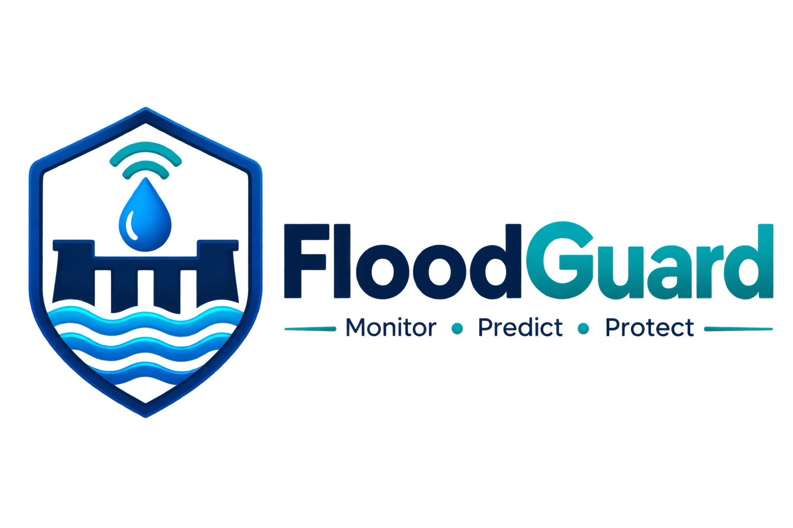
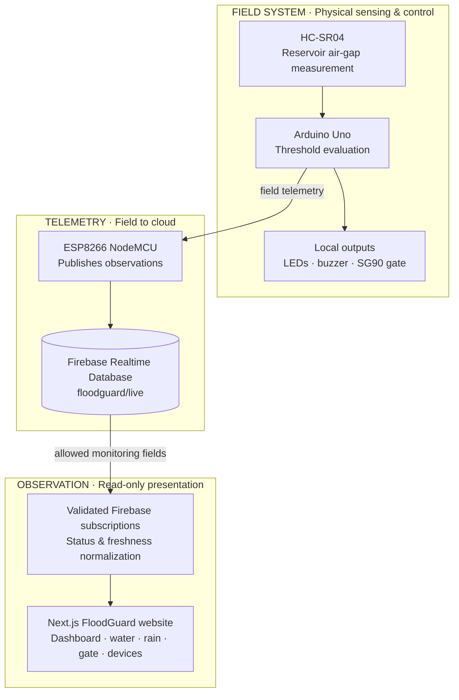

<p align="center">
  <a href="https://floodguard-website-teldigi5-wq.vercel.app/">
    
  </a>
</p>

<h1 align="center">FloodGuard</h1>

<p align="center">
  <strong>Monitor. Predict. Protect.</strong><br />
  <sub>From physical sensing to clear, responsible flood-monitoring experiences.</sub>
</p>

<p align="center">
  <a href="https://floodguard-website-teldigi5-wq.vercel.app/"><strong>Explore the website ↗</strong></a>
  &nbsp;·&nbsp;
  <a href="https://floodguard-website-teldigi5-wq.vercel.app/dashboard/">Monitoring dashboard</a>
  &nbsp;·&nbsp;
  <a href="https://floodguard-website-teldigi5-wq.vercel.app/diagnostics/">Diagnostics</a>
  &nbsp;·&nbsp;
  <a href="#system-architecture">Architecture</a>
  &nbsp;·&nbsp;
  <a href="#run-locally">Get started</a>
</p>

<p align="center">
  <a href="https://github.com/teldigi5-wq/floodguard-website/actions/workflows/ci.yml"></a>
  
  
  
  
</p>

---

## The idea

Flood conditions change in the physical world—not on a dashboard. A useful monitoring interface must communicate what the sensors **actually reported**, when they reported it, and whether those observations are still current.

**FloodGuard** is an educational, end-to-end IoT prototype built around that principle. An Arduino-based field controller measures reservoir water conditions, evaluates predefined thresholds, and drives the local alarm and model gate. An ESP8266 publishes observations to Firebase Realtime Database. This Next.js website turns those readings into a responsive monitoring experience.

**Its defining UX decision:** when the field system powers down, the most recent measurements remain visible as **last recorded**, clearly distinguished from fresh telemetry. No synthetic sensor values, no imaginary history, and no misleading claim that a connected browser means connected hardware.

> [!IMPORTANT]
> **Educational prototype, not a life-safety system.** FloodGuard is not certified for flood prediction, emergency warning, or real dam operation. Never rely on its displays to make safety-critical decisions. The **Arduino firmware**, not this website, controls the prototype gate and alarm.

## Experience highlights

| Experience | What it delivers |
| :--- | :--- |
| **Monitoring dashboard** | Consolidated reservoir, alarm, gate, risk, and network readings |
| **Reservoir intelligence** | Visual water-level display, calibrated HC-SR04 air-gap conversion, and transparent threshold bands |
| **Gate digital twin** | Three-dimensional representation of the last reported SG90 angle and countdown; the center bay represents the prototype gate |
| **Rainfall telemetry** | Collector-depth readings, reported rainfall category, sensor status, raw values, and calibration limitations when available |
| **Device health** | Visibility into Arduino, ESP8266, ultrasonic sensor, RTC, servo, and reported rain-gauge state |
| **Responsible connection states** | Independently tested **Live**, **Last recorded**, and **Unavailable** states—without hiding valid historical observations |
| **Engineering diagnostics** | Read-only telemetry coverage, reported source timestamp, Firebase client connection, last field risk and gate state |
| **Presentation-ready interaction** | Responsive layouts, restrained motion, reduced-motion handling, quick navigation, and exportable current observations |
| **Educational storytelling** | Architecture, project context, safety guidance, and impact pages |

The website **monitors** gate activity; it does not send actuator commands. Its export function captures the browser's current observation, **not** a fabricated time-series archive.

## Explore the interface

| Route | Section | Route | Section |
| :--- | :--- | :--- | :--- |
| [`/`](https://floodguard-website-teldigi5-wq.vercel.app/) | Home | [`/dashboard/`](https://floodguard-website-teldigi5-wq.vercel.app/dashboard/) | Monitoring overview |
| [`/water/`](https://floodguard-website-teldigi5-wq.vercel.app/water/) | Water levels | [`/rainfall/`](https://floodguard-website-teldigi5-wq.vercel.app/rainfall/) | Rainfall |
| [`/gate/`](https://floodguard-website-teldigi5-wq.vercel.app/gate/) | Gate digital twin | [`/devices/`](https://floodguard-website-teldigi5-wq.vercel.app/devices/) | Device status |
| [`/diagnostics/`](https://floodguard-website-teldigi5-wq.vercel.app/diagnostics/) | Engineering observability | — | — |
| [`/system/`](https://floodguard-website-teldigi5-wq.vercel.app/system/) | System architecture | [`/safety/`](https://floodguard-website-teldigi5-wq.vercel.app/safety/) | Safety guidance |
| [`/impact/`](https://floodguard-website-teldigi5-wq.vercel.app/impact/) | Human impact | [`/about/`](https://floodguard-website-teldigi5-wq.vercel.app/about/) | About the project |

## System architecture

FloodGuard separates **physical control** from **remote observation**. Loss of network connectivity must not transfer gate authority to the website.



**Other FloodGuard components**, such as the mobile application and WhatsApp alert workflow, belong to the wider prototype ecosystem; their code is **not** hosted in this website repository.

### Field hardware and decision logic

The interface models an Arduino Uno R3, ESP8266 NodeMCU, HC-SR04, SG90 servo, local LEDs/buzzer, RTC, and 16×2 I²C LCD. Physical components and their real-world availability should always be verified against the assembled prototype.

With the configured **25.0 cm sensor-to-bottom calibration**:

```text
Actual water level (cm) = 25.0 − HC-SR04 distance (cm)
```

| Actual level | Prototype classification | Controller response |
| :--- | :--- | :--- |
| Below **8.5 cm** | SAFE | Green indication; gate remains closed |
| **8.5 cm** to below **11.0 cm** | WARNING | Yellow indication; gate remains closed |
| **11.0 cm** or above | DANGER | Local alarm; firmware-managed countdown and gate-opening sequence |

These thresholds are **prototype configuration values**, not universal flood thresholds. The website mirrors reported conditions; firmware and sensor calibration remain the authoritative implementation.

## Truthful telemetry by design

A Firebase database can retain measurements long after the ESP8266 stops sending updates. FloodGuard intentionally preserves those retained observations rather than discarding them when they become old.

| Interface state | Meaning | Display behavior |
| :--- | :--- | :--- |
| **Live** | Readings are present, the Firebase connection is established, and the recorded field timestamp is recent | Show fresh values |
| **Last recorded** | Firebase still holds measurements, but their freshness cannot be confirmed | Keep the measurements **with the original timestamp and a historical-data warning** |
| **Unavailable** | No usable telemetry has been retrieved yet | Show missing values as unavailable; never substitute zero or SAFE |

**A connection to Firebase is not evidence that the physical hardware is online.** The freshness indicator uses the recorded `system.lastUpdate` value. Previously reported gate positions or alarms are historical when freshness is stale.

### Firebase data contract

The website subscribes to permitted child paths under `/floodguard/live` rather than reading the entire parent node:

| Path | Expected observation |
| :--- | :--- |
| `water` | `distanceCm`, `levelCm`, `status` |
| `rain` | Current/daily rainfall, collector depth, raw value, calibration flags, sensor/category status |
| `gate` | `status`, `angle`, `countdownSeconds`, `reason` |
| `alarm` | `active`, `type` |
| `devices` | Reported device states |
| `system` | `lastUpdate`, `overallRisk` |
| `esp8266/connection`, `esp8266/rssi`, `esp8266/status` | Allowlisted connection telemetry |

Incoming data is validated and normalized before reaching the interface. Missing optional fields remain unavailable. The current collector-based rain gauge does **not** imply a load-cell measurement; weight is not invented.

## Technology

| Layer | Implementation |
| :--- | :--- |
| Web app | **Next.js 16**, React 19, TypeScript |
| Styling & interaction | CSS / Tailwind toolchain, Framer Motion, Lucide |
| Spatial visualization | Three.js, React Three Fiber, Drei |
| Data transport | Firebase Realtime Database SDK with realtime listeners |
| Validation | Zod schemas and normalization |
| Verification | Node.js source tests, ESLint, TypeScript checks, Next.js build |
| Hosting | Vercel, GitHub-connected deployments from `main` |

The Next.js configuration uses **static export**. Browser-side Firebase subscriptions provide telemetry, so no Next.js server process is needed to serve these pages.

## Run locally

**Requirements:** Node.js **22.13.0+**, npm, and access to a Firebase Realtime Database configured with the appropriate read permissions.

```bash
git clone https://github.com/teldigi5-wq/floodguard-website.git
cd floodguard-website
npm ci
cp .env.example .env.local
npm run dev
```

On Windows PowerShell, use `Copy-Item .env.example .env.local` instead of `cp`.

Configure `.env.local`:

```dotenv
NEXT_PUBLIC_FIREBASE_DATABASE_URL=https://your-project-default-rtdb.region.firebasedatabase.app
NEXT_PUBLIC_FIREBASE_LIVE_PATH=floodguard/live
NEXT_PUBLIC_SITE_URL=http://localhost:3000
```

Open **http://localhost:3000**. Use the correct RTDB URL for your own environment; this repository deliberately does **not** silently default to a previously used Firebase project.

> [!NOTE]
> Variables prefixed `NEXT_PUBLIC_` are included in browser-side output. **Never store passwords, Firebase service-account JSON, private keys, or device tokens in them.** Changing these values on Vercel requires a new build/deployment.

### Verify your changes

```bash
npm run test
npm run lint
npm run typecheck
npm run build
```

GitHub Actions runs these checks on pushes and pull requests to `main`. The source tests include route coverage, Firebase subscription/rule expectations, and behavioral regression cases for invalid timestamps, stale hardware reports and connection loss.

## Deploy to Vercel

1. Import `teldigi5-wq/floodguard-website` into Vercel and select the **Next.js** framework.
2. Set the three public environment variables listed above for the intended deployment environments.
3. Deploy from `main`. Vercel builds the static Next.js output and assigns a deployment URL.
4. Check the dashboard, Firebase permissions, gate digital twin, stale-data behavior, and mobile layouts on the deployed website.

**Current deployment:** [floodguard-website-teldigi5-wq.vercel.app](https://floodguard-website-teldigi5-wq.vercel.app/)

This repository was recovered from an earlier **AWS Amplify** website package. The Vercel deployment is separate; the original Amplify website is not overwritten.


## Engineering status and next milestones

FloodGuard is now a **public, working engineering prototype**, not a certified production dam-control platform.

| Capability | Status | Evidence / limits |
| :--- | :--- | :--- |
| Public source and documented architecture | **Implemented** | GitHub repo, system architecture and field authority ADR |
| Firebase subscriptions and retained readings | **Implemented** | Live RTDB listeners with Zod validation; source timestamps remain visible |
| Deterministic freshness model | **Implemented** | Pure functions tested against old, absent, future and disconnected observations |
| Engineering diagnostics | **Implemented** | [Read-only diagnostics](https://floodguard-website-teldigi5-wq.vercel.app/diagnostics/) for reported group availability and field freshness |
| Source checks and reproducible builds | **Implemented** | GitHub Actions for test, lint, typecheck and static export |
| Dependency maintenance and static analysis | **Configured** | Dependabot and CodeQL; check Security / Actions for results |
| Deployed Firebase writer authentication | **Not independently verified** | Must be validated before updating real RTDB rules |
| Persisted, append-only time-series history | **Planned** | The current RTDB live snapshot is not a historical analytics database |
| Firebase Emulator integration and Playwright end-to-end tests | **Planned** | CI presently verifies source and builds, not complete hardware/browser behavior |
| Certified flood-warning and physical dam automation | **Out of scope** | Educational, safety-bounded prototype |

See [the detailed roadmap](./docs/ENGINEERING_ROADMAP.md) for priorities, acceptance criteria and remaining limitations.

> [!WARNING]
> **Active Firebase rules finding:** During the public-release audit on 13 October 2026, anonymous read requests were able to retrieve private ESP8266 network metadata from the deployed database. **No private values are reproduced here.** The repository rules file is not necessarily deployed, and security remediation remains **open**. See [Firebase security](./FIREBASE_SECURITY.md). Do not promote this prototype as security-certified.

## Security and operational boundaries

- **Read-only client:** The website observes allowed telemetry. It is not a remote gate controller.
- **Firebase rules:** [`firebase.rules.json`](./firebase.rules.json) is a reviewed **repository template**, not proof of which rules are currently active in the cloud.
- **Controller authentication:** Confirm hardware writer authentication **before** applying restrictive rules, or firmware telemetry writes may stop.
- **Private network fields:** The website intentionally does not subscribe to ESP8266 IP/Wi-Fi details.
- **No synthetic safety data:** Missing sensor readings are never silently fabricated, and retained readings are explicitly labeled historical.
- **No certified emergency capability:** The prototype does not replace official warnings, qualified engineering review, or public emergency services.

For security controls and operations, see [security policy](./SECURITY.md), [Firebase security](./FIREBASE_SECURITY.md), [engineering roadmap](./docs/ENGINEERING_ROADMAP.md), [architecture decision record](./docs/architecture/0001-field-authority-and-freshness.md), [contributing guide](./CONTRIBUTING.md) and the [Vercel deployment guide](./VERCEL_DEPLOYMENT_GUIDE.md).

### Troubleshooting

| Symptom | What to check |
| :--- | :--- |
| **Last recorded** shown while hardware is off | Expected: Firebase retains the last field values; inspect the original update timestamp |
| **Unavailable** after page load | RTDB URL, public read permissions for the specific child paths, browser console, and network access |
| Gate visualization appears out of date | Check `gate/angle`, `gate/status`, `gate/countdownSeconds`, and `system/lastUpdate` |
| Build works locally but not on Vercel | Node.js version, environment variables, and the latest Vercel build logs |
| Measurements differ from the physical reservoir | Verify sensor installation and the **25.0 cm** calibration against the firmware |

## Project context

**SLIIT · Faculty of Computing · Group WD26**  
An undergraduate engineering project exploring affordable environmental sensing, embedded control, realtime data communication, and responsible interface design.

**Maintainer:** [teldigi5-wq](https://github.com/teldigi5-wq)

This repository is **publicly readable**, but it does **not** include an open-source license. Public visibility does not grant reuse or redistribution rights; please request permission from the maintainer.

---

<p align="center">
  <strong>FloodGuard</strong><br />
  <sub>Designed to make sensor observations understandable—without confusing old information with live certainty.</sub>
</p>
